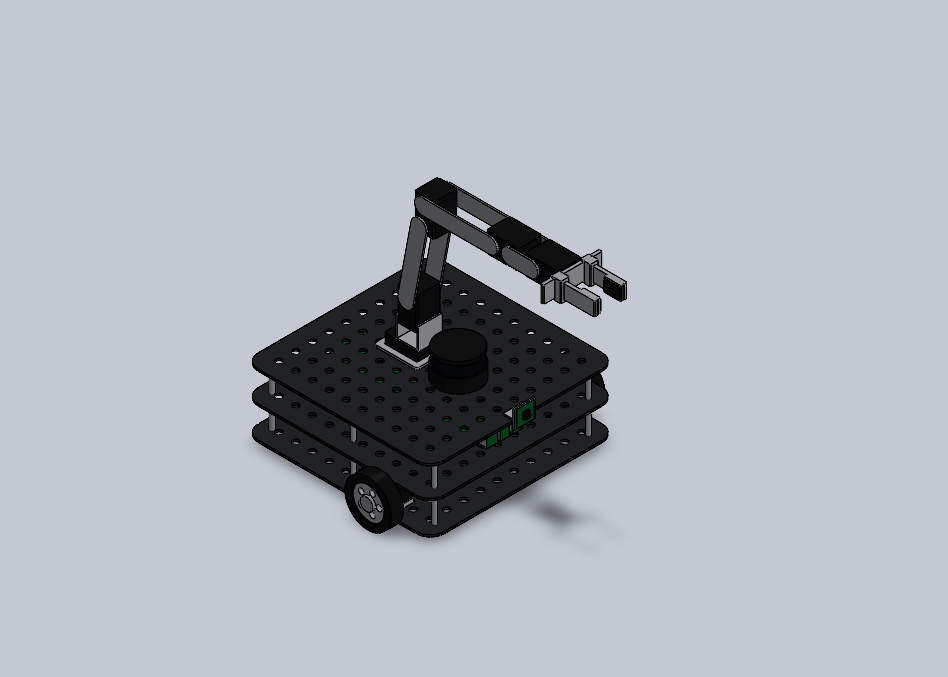

# Collision-Free Motion Planning for Mobile Manipulator During Material Handling

A TurtleBot3 Waffle Pi carrying an OpenMANIPULATOR-X arm: a parametric SolidWorks model, a ROS 2 Humble description package, and a simulation-based comparison of three sampling-based motion planners (RRT, RRT*, PRM).

Subject: Robot Dynamic Control.

**Team:** Kaviyashree T S, Barath K M, Jyothish S, Nabeeha Naaz H



## Repository layout

| Folder | Content |
|---|---|
| `docs/` | Project review report (`.docx`, `.pdf`) and slides (`.pptx`, `.pdf`) |
| `robot_model/` | SolidWorks 2025 parts and assemblies, STEP file, ROS 2 URDF package with STL meshes, renders, generator scripts (see its own README) |
| `scripts/` | Python code for the planner benchmark, per-algorithm simulations, architecture diagrams, equations, and the document builder |
| `figures/` | Architecture, simulation and result figures used in the report |

## Results (standalone Python benchmark, 10 runs per planner)

The scene has three spherical obstacles that block the straight joint-space path (length 2.40 rad), so every planner has to find a detour.

| Algorithm | Success | First solution (ms) | Path length (rad) | Above 2.40 rad lower bound | Nodes |
|---|---|---|---|---|---|
| RRT | 10/10 | 43 | 4.32 | 80 % | 36 |
| RRT* (10 s budget) | 10/10 | 87 | 2.83 | 18 % | 1661 |
| PRM (1500 nodes) | 10/10 | 10694 (roadmap build + query) | 3.64 | 52 % | 1500 |

RRT is the quickest, RRT* gives the shortest and most repeatable paths, PRM pays up front so the roadmap can be reused.

**Scope note:** the planners are our own Python implementations, not OMPL. The MoveIt 2 / OMPL / Gazebo comparison is the next step. The arm dynamics (computed-torque control) appear in the report as equations only.

## Run the benchmark

Needs Python 3.10+.

```bash
cd scripts
python3 -m venv .venv && source .venv/bin/activate
pip install -r requirements.txt
mkdir -p out
python bench.py     # RRT / RRT* / PRM comparison, about 5 minutes -> out/bench.json, bench.png, paths.png, workspace.png
python sim.py       # per-algorithm simulation figures and PRM size study -> out/sim_*.png, sim.json
python arch.py      # architecture diagrams and equation images -> out/arch_*.png, eq_*.png
python build_documents.py   # rebuilds the report and slides into out/
```

Results vary slightly from run to run because planning times depend on the machine and the random seeds.

## ROS 2 model

See `robot_model/README.md` for the SolidWorks files, the URDF package and how to use it with MoveIt 2 and Gazebo.

## References

The full reference list is in the report (`docs/`).
