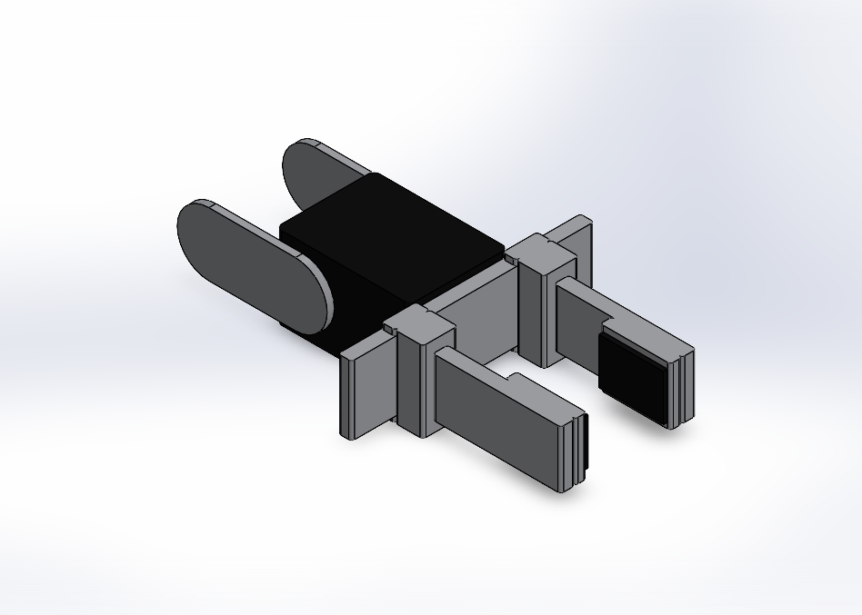

# Mobile Manipulator: TurtleBot3 + OpenMANIPULATOR-X

A SolidWorks 2025 model of the **TurtleBot3 Waffle Pi** mobile base carrying an
**OpenMANIPULATOR-X** arm. Every part has editable parameters. The package also includes a
ROS 2 description (URDF + meshes) for your motion-planning project: MoveIt 2 + OMPL (RRT / RRT* / PRM) + Gazebo.


## Folder contents

| Folder | What is inside |
|---|---|
| `01_SolidWorks_2025/` | 19 parametric parts (`.SLDPRT`) + 2 assemblies (`.SLDASM`), saved with SolidWorks 2025 |
| `02_STEP/` | Whole robot as one STEP file, for other CAD tools |
| `03_ROS2_URDF/tb3_omx_description/` | ROS 2 package: URDF, xacro, STL meshes, RViz launch, Gazebo/MoveIt drop-in script |
| `04_Renders/` | Images of the assembly and of every part |
| `tools/` | Python scripts that regenerate everything (SolidWorks API + URDF writer) |

## SolidWorks 2025

Open **`01_SolidWorks_2025/ASM00_TB3_OpenManipulatorX.SLDASM`**. Keep all files of this folder
together. Parts and assemblies sit in one folder, so SolidWorks finds the references wherever you unzip.

| File | Content |
|---|---|
| `ASM00_TB3_OpenManipulatorX.SLDASM` | Complete robot (origin = ground, `base_footprint`) |
| `ASM01_TB3_Waffle_Pi_Base.SLDASM` | Mobile base subassembly (origin = `base_link`, 10 mm above ground) |
| `TB01..TB13_*.SLDPRT` | TurtleBot3 Waffle Pi parts: waffle plates, PCB supports, DYNAMIXEL XM430, bracket, battery, OpenCR, Raspberry Pi 4, ball caster, Pi camera, LDS-01, wheel |
| `OM01..OM06_*.SLDPRT` | OpenMANIPULATOR-X: link1 ... link5 (each with its DYNAMIXEL) and gripper finger |

**Moving the arm in SolidWorks.** Joints 1 to 4 are mated as real revolute joints: a collinear
axis mate plus a coincident plane on each joint. The wheels rotate on their axle. Drag a link
to move it.

**Two-finger gripper (end effector).** The gripper DYNAMIXEL and a guide rail sit on link5.
Two parallel fingers (`OM06_Gripper_Finger`, the right one is the same part flipped 180 deg)
clamp onto the rail with top and bottom lips. Each finger carries a jaw and a rubber grip pad,
and the pads face each other. Each finger is a slider mate with a limit mate (-10 ... +19 mm
from the 21 mm home position, same as the URDF), so the jaw opening runs from about 6 mm to 64 mm.
The tool point `end_effector_link` is at the finger tips (link5 x = 126 mm).



**Parameters.** In any part, open *Tools > Equations* (Global Variables), change a value and
rebuild. All sketch and feature dimensions are linked to these variables. Examples: `J3_Z`
(upper-arm length), `J4_X` (forearm length), `Hole_P` / `Hole_N` (waffle hole grid), `Tire_D`
(wheel). If you change a joint offset, change the same value in `tools/robot_spec.py` and rerun
`tools/build_robot.py` + `tools/gen_urdf.py` so the assembly and the URDF follow.

**Coordinates.** Parts are modelled in the ROS convention (x forward, y left, z up) and mapped
onto the SolidWorks axes, so the robot stands upright in the *Isometric* view. Each arm link,
wheel, finger and the LiDAR has its part origin exactly on its URDF link frame. Reference
planes and axes (`J1_Axis`, `J2_Axis`, ..., `G_XP`) mark the joint locations.

## Kinematics (identical to the official ROBOTIS model)

| Joint | Parent -> child | Origin (m) | Axis | Limits |
|---|---|---|---|---|
| base_fixed | base_link -> link1 | (-0.092, 0, 0.091) | fixed | - |
| joint1 | link1 -> link2 | (0.012, 0, 0.017) | z | +/- 0.9 pi |
| joint2 | link2 -> link3 | (0, 0, 0.0595) | y | -0.57 pi ... 0.5 pi |
| joint3 | link3 -> link4 | (0.024, 0, 0.128) | y | -0.3 pi ... 0.44 pi |
| joint4 | link4 -> link5 | (0.124, 0, 0) | y | -0.57 pi ... 0.65 pi |
| gripper_left/right | link5 -> gripper | (0.0817, +/-0.021, 0) | +/-y | -0.010 ... 0.019 m |
| end_effector_joint | link5 -> end_effector_link | (0.126, 0, 0) | fixed | - |
| wheel_left/right | base_link -> wheel | (0, +/-0.144, 0.023) | z (rpy -1.57) | continuous |

All 18 joints (origin, rpy, type and axis) were checked automatically against
`turtlebot3_manipulation_description` (ROS 2 Humble branch).

## ROS 2 (Humble, Ubuntu 22.04)

```bash
cd ~/turtlebot3_ws/src
cp -r <unzipped>/03_ROS2_URDF/tb3_omx_description .
cd ~/turtlebot3_ws && colcon build --symlink-install --packages-select tb3_omx_description
source install/setup.bash
ros2 launch tb3_omx_description display.launch.py      # RViz + joint sliders
```

* `urdf/tb3_omx.urdf`: standalone URDF that needs no other package. Use it in RViz, for
  `check_urdf`, or to import the robot into another tool.
* `urdf/tb3_omx.urdf.xacro`: drop-in version that reuses the official Gazebo plugins,
  ros2_control hardware and controllers from `turtlebot3_manipulation_description`.

### Gazebo + MoveIt 2 (for the motion-planning comparison)

The official launch files always load
`turtlebot3_manipulation_description/urdf/turtlebot3_manipulation.urdf.xacro`. The helper
script swaps that file for the one in this package and keeps a backup:

```bash
cd ~/turtlebot3_ws/src
git clone -b humble https://github.com/ROBOTIS-GIT/turtlebot3_manipulation.git
git clone -b humble https://github.com/ROBOTIS-GIT/turtlebot3_simulations.git
sudo apt install ros-humble-dynamixel-sdk ros-humble-ros2-control ros-humble-ros2-controllers ros-humble-gripper-controllers ros-humble-moveit*
bash tb3_omx_description/scripts/use_with_turtlebot3_manipulation.sh ~/turtlebot3_ws
cd ~/turtlebot3_ws && colcon build --symlink-install && source install/setup.bash
ros2 launch turtlebot3_manipulation_moveit_config moveit_gazebo.launch.py
```

Undo it with `use_with_turtlebot3_manipulation.sh ~/turtlebot3_ws --undo`.
Link and joint names are unchanged, so the official SRDF, `ompl_planning.yaml` (choose
`RRTkConfigDefault`, `RRTstarkConfigDefault` or `PRMkConfigDefault` in the RViz MotionPlanning
panel), controllers and Nav2 configuration all work as they are.

Meshes are in metres, ROS frame, binary STL. Inertial values are the official ROBOTIS values
(measured hardware). Base and wheel collisions use the official primitives; arm collisions use
the link meshes.

## Notes and limits

* Purchased components (DYNAMIXEL XM430-W210, OpenCR 1.0, Raspberry Pi 4, LiPo LB-012,
  LDS-01, Pi camera) are simplified envelope models built from their main published dimensions.
  They are not the vendors' detailed CAD.
* The waffle plates are modelled as single 266 x 266 mm plates with a parametric hole grid.
  This matches the official collision footprint and wheel/caster positions.
* SolidWorks material is assigned per part (ABS, 6061 alloy, ...). It is used only for the
  SolidWorks mass properties; the URDF uses the official inertials.

## Regenerating (Windows + SolidWorks 2025 + Python 3 with pywin32)

```bash
cd tools
python build_robot.py C:\temp\tb3omx        # parts, assemblies, renders, STEP, raw meshes
python gen_urdf.py C:\temp\tb3omx ..\03_ROS2_URDF\tb3_omx_description
```

Keep the build folder path short, because SolidWorks rejects paths longer than about 255 characters.

## Part parameters (Tools > Equations in each part)

#### OM01_Link1
Size 62.0 x 44.0 x 34.0 mm, mass 0.050 kg (SolidWorks material)

| Global variable | Value | Meaning |
|---|---|---|
| `XM_L` | 46.5 | DYNAMIXEL XM430 length |
| `XM_W` | 28.5 | DYNAMIXEL XM430 width |
| `XM_D` | 34 | DYNAMIXEL XM430 depth (along horn axis) |
| `Horn_Off` | 12 | horn axis offset from body centre |
| `Horn_D` | 22 | horn diameter |
| `Horn_T` | 2.5 | horn thickness |
| `J1_X` | 12 | joint1 axis x (URDF) |
| `J1_Z` | 17 | joint1 height (URDF) = DYNAMIXEL top face |
| `Base_L` | 62 | base frame length |
| `Base_W` | 44 | base frame width |
| `Base_T` | 3 | base frame thickness |

#### OM02_Link2
Size 32.5 x 34.0 x 70.8 mm, mass 0.053 kg (SolidWorks material)

| Global variable | Value | Meaning |
|---|---|---|
| `XM_L` | 46.5 | DYNAMIXEL XM430 length |
| `XM_W` | 28.5 | DYNAMIXEL XM430 width |
| `XM_D` | 34 | DYNAMIXEL XM430 depth (along horn axis) |
| `Horn_Off` | 12 | horn axis offset from body centre |
| `Horn_D` | 22 | horn diameter |
| `Horn_T` | 2.5 | horn thickness |
| `J2_Z` | 59.5 | joint2 height above joint1 (URDF) |
| `Br_T` | 2 | bracket height (sets wheel axle height 33 mm) |
| `Wall_Z1` | 34 | bracket side wall top (follows joint 2) |

#### OM03_Link3
Size 49.2 x 39.0 x 150.2 mm, mass 0.059 kg (SolidWorks material)

| Global variable | Value | Meaning |
|---|---|---|
| `XM_L` | 46.5 | DYNAMIXEL XM430 length |
| `XM_W` | 28.5 | DYNAMIXEL XM430 width |
| `XM_D` | 34 | DYNAMIXEL XM430 depth (along horn axis) |
| `Horn_Off` | 12 | horn axis offset from body centre |
| `Horn_D` | 22 | horn diameter |
| `Horn_T` | 2.5 | horn thickness |
| `Frame_W` | 22 | frame plate width |
| `Frame_T` | 2.5 | frame plate thickness |
| `J3_X` | 24 | joint3 x offset from joint2 (URDF) |
| `J3_Z` | 128 | joint3 z offset from joint2 (URDF) |
| `Frame_Z1` | 100 | frame plates upper end (follows joint 3) |

#### OM04_Link4
Size 146.2 x 39.0 x 28.5 mm, mass 0.059 kg (SolidWorks material)

| Global variable | Value | Meaning |
|---|---|---|
| `XM_L` | 46.5 | DYNAMIXEL XM430 length |
| `XM_W` | 28.5 | DYNAMIXEL XM430 width |
| `XM_D` | 34 | DYNAMIXEL XM430 depth (along horn axis) |
| `Horn_Off` | 12 | horn axis offset from body centre |
| `Horn_D` | 22 | horn diameter |
| `Horn_T` | 2.5 | horn thickness |
| `Frame_W` | 22 | frame plate width |
| `Frame_T` | 2.5 | frame plate thickness |
| `J4_X` | 124 | joint4 x offset from joint3 (URDF) |
| `Frame_X1` | 96 | frame plates end (follows joint 4) |

#### OM05_Link5
Size 83.0 x 84.0 x 28.5 mm, mass 0.061 kg (SolidWorks material)

| Global variable | Value | Meaning |
|---|---|---|
| `XM_L` | 46.5 | DYNAMIXEL XM430 length |
| `XM_W` | 28.5 | DYNAMIXEL XM430 width |
| `XM_D` | 34 | DYNAMIXEL XM430 depth (along horn axis) |
| `Horn_Off` | 12 | horn axis offset from body centre |
| `Horn_D` | 22 | horn diameter |
| `Horn_T` | 2.5 | horn thickness |
| `Frame_W` | 22 | frame plate width |
| `Frame_T` | 2.5 | frame plate thickness |
| `Grip_X` | 81.7 | finger joint x (URDF) |
| `EE_X` | 126 | end_effector_link x (URDF) |
| `GM_X` | 44 | gripper DYNAMIXEL centre x |
| `Frame_X1` | 30 | frame plates end (follows joint 4) |
| `Rail_T` | 4.75 | gripper base / guide rail thickness (fingers ride on its front face) |
| `Rail_L` | 84 | gripper base plate length (y) |
| `Rail_H` | 24 | gripper base plate height |
| `Grip_Ref` | 60 | finger travel reference plane offset (|y|) |

#### OM06_Gripper_Finger
Size 58.8 x 14.0 x 28.0 mm, mass 0.011 kg (SolidWorks material)

| Global variable | Value | Meaning |
|---|---|---|
| `Car_L` | 9.7 | slider block length (rides on the gripper base) |
| `Car_W` | 12 | slider block width (y) |
| `Fin_L` | 44.3 | finger length (tip = end_effector_link) |
| `Fin_T` | 5 | finger thickness (y) |
| `Fin_H` | 20 | finger height |
| `Rail_T` | 4.75 | gripper base / guide rail thickness (fingers ride on its front face) |
| `Rail_H` | 24 | gripper base plate height |
| `Lip_T` | 2 | lip thickness clamping over the rail |
| `Jaw_X0` | 20 | jaw start along the finger |
| `Jaw_D` | 4 | jaw depth towards the object |
| `Pad_T` | 1.5 | rubber grip pad thickness |
| `Pad_H` | 16 | rubber grip pad height |

#### TB01_Waffle_Plate
Size 266.0 x 266.0 x 3.0 mm, mass 0.196 kg (SolidWorks material)

| Global variable | Value | Meaning |
|---|---|---|
| `Plate_L` | 266 | plate length along x |
| `Plate_W` | 266 | plate width along y |
| `Plate_X` | -64 | plate centre x in base_link |
| `Plate_R` | 20 | corner radius |
| `Plate_T` | 3 | plate thickness |
| `Hole_D` | 9 | waffle hole diameter |
| `Hole_P` | 24 | waffle hole pitch |
| `Hole_N` | 10 | holes per row / column |

#### TB02_Waffle_Plate_Top
Size 266.0 x 266.0 x 3.0 mm, mass 0.192 kg (SolidWorks material)

| Global variable | Value | Meaning |
|---|---|---|
| `Plate_L` | 266 | plate length along x |
| `Plate_W` | 266 | plate width along y |
| `Plate_X` | -64 | plate centre x in base_link |
| `Plate_R` | 20 | corner radius |
| `Plate_T` | 3 | plate thickness |
| `Hole_D` | 9 | waffle hole diameter |
| `Hole_P` | 24 | waffle hole pitch |
| `Hole_N` | 10 | holes per row / column |
| `Arm_X` | -92 | OpenMANIPULATOR link1 x in base_link |
| `Cut_L` | 50 | joint-1 DYNAMIXEL cut-out length |
| `Cut_W` | 32 | joint-1 DYNAMIXEL cut-out width |

#### TB03_PCB_Support_42
Size 6.0 x 6.0 x 42.0 mm, mass 0.002 kg (SolidWorks material)

| Global variable | Value | Meaning |
|---|---|---|
| `SO_L` | 42 | spacer length |
| `SO_D` | 6 | outer diameter |
| `SO_Bore` | 3.2 | M3 bore |

#### TB04_PCB_Support_40
Size 6.0 x 6.0 x 40.0 mm, mass 0.002 kg (SolidWorks material)

| Global variable | Value | Meaning |
|---|---|---|
| `SO_L` | 40 | spacer length |
| `SO_D` | 6 | outer diameter |
| `SO_Bore` | 3.2 | M3 bore |

#### TB05_DYNAMIXEL_XM430_W210
Size 46.5 x 28.5 x 38.0 mm, mass 0.052 kg (SolidWorks material)

| Global variable | Value | Meaning |
|---|---|---|
| `XM_L` | 46.5 | DYNAMIXEL XM430 length |
| `XM_W` | 28.5 | DYNAMIXEL XM430 width |
| `XM_D` | 34 | DYNAMIXEL XM430 depth (along horn axis) |
| `Horn_Off` | 12 | horn axis offset from body centre |
| `Horn_D` | 22 | horn diameter |
| `Horn_T` | 2.5 | horn thickness |

#### TB06_Motor_Bracket
Size 46.5 x 34.0 x 5.8 mm, mass 0.025 kg (SolidWorks material)

| Global variable | Value | Meaning |
|---|---|---|
| `Br_L` | 46.5 | bracket length |
| `Br_W` | 34 | bracket width |
| `Br_T` | 5.75 | bracket height (sets wheel axle height 33 mm) |

#### TB07_LiPo_Battery
Size 96.0 x 35.0 x 26.5 mm, mass 0.084 kg (SolidWorks material)

| Global variable | Value | Meaning |
|---|---|---|
| `Bat_L` | 88 | length |
| `Bat_W` | 35 | width |
| `Bat_H` | 26.5 | height |

#### TB08_OpenCR_Board
Size 105.0 x 75.0 x 10.6 mm, mass 0.019 kg (SolidWorks material)

| Global variable | Value | Meaning |
|---|---|---|
| `PCB_L` | 105 | board length |
| `PCB_W` | 75 | board width |
| `PCB_T` | 1.6 | board thickness |

#### TB09_Raspberry_Pi_4
Size 85.0 x 56.0 x 16.9 mm, mass 0.023 kg (SolidWorks material)

| Global variable | Value | Meaning |
|---|---|---|
| `PCB_L` | 85 | board length |
| `PCB_W` | 56 | board width |
| `PCB_T` | 1.4 | board thickness |

#### TB10_Ball_Caster
Size 20.0 x 20.0 x 10.0 mm, mass 0.017 kg (SolidWorks material)

| Global variable | Value | Meaning |
|---|---|---|
| `Cas_D` | 20 | housing diameter |
| `Cas_H` | 6 | housing height |
| `Ball_D` | 8 | ball diameter |

#### TB11_Pi_Camera
Size 21.0 x 30.0 x 26.0 mm, mass 0.003 kg (SolidWorks material)

| Global variable | Value | Meaning |
|---|---|---|
| `Front_X` | 69 | front edge of the waffle plates |
| `Br_T` | 2 | bracket height (sets wheel axle height 33 mm) |
| `Br_W` | 30 | bracket width |
| `Br_Z0` | 80 | bracket bottom |
| `Br_Z1` | 106 | bracket top |
| `Cam_S` | 25 | camera board size |
| `Lens_D` | 8 | lens diameter |
| `Lens_Z` | 93 | lens centre height (camera_rgb_frame) |

#### TB12_LDS01_Lidar
Size 60.0 x 60.0 x 39.5 mm, mass 0.107 kg (SolidWorks material)

| Global variable | Value | Meaning |
|---|---|---|
| `Base_D` | 60 | base diameter |
| `Base_Z0` | -31 | base bottom (sits on the top plate) |
| `Turret_D` | 56 | rotating turret diameter |
| `Turret_Z0` | -12 | turret bottom |
| `Turret_Z1` | 3 | turret top |
| `Cap_D` | 58 | cap diameter |
| `Cap_Z1` | 8.5 | cap top |

#### TB13_Wheel
Size 66.0 x 66.0 x 22.0 mm, mass 0.054 kg (SolidWorks material)

| Global variable | Value | Meaning |
|---|---|---|
| `Tire_D` | 66 | tire outer diameter (URDF radius 0.033) |
| `Tire_W` | 18 | tire width (URDF length 0.018) |
| `Rim_D` | 46 | rim diameter |
| `Rim_W` | 14 | rim width |
| `Hub_D` | 18 | hub diameter |
| `Hub_W` | 22 | hub width |
